# Tudor for VCV Rack

Twelve modules after three pieces by David Tudor: *Rainforest* (1968 to 1976), *Pulsers* (1976) and *Phonemes* (1981), with the components of *Untitled* (1972) that *Pulsers* grew from. They are not copies of Tudor's circuits, which were never documented. They model what Tudor and the people who worked with him said the circuits did, and they make his ways of working practical in Rack: sounding objects instead of loudspeakers, feedback instead of oscillators, and chopping and stretching instead of sequencing.

| Group | Modules |
|---|---|
| Rainforest (green stripe) | OBJECT, CRITTER, SEEK, WANDER |
| Pulsers (rust stripe) | PULSER, SHIFT, TUNED, SIDEBAND, LOOP |
| Phonemes (blue stripe) | SWELL, PHONEME, XGATE |

Search for any module in Rack's browser by its name or its three-letter short name (OBJ, CRT, SEK, WND, PLS, SHF, TND, SBM, LOP, SWL, PHN, XGT).

## Conventions

- **Levels.** Audio is ±5 V. CV is ±5 V or 0 to 10 V. Pitch is 1 V/oct with 0 V = C4. Triggers fire on a rise through 1 V. Every output is soft-limited at ±12 V, so feedback patches stay bounded.
- **Jack colours.** Grey ring: audio. Blue: CV and pitch. Red: gate or trigger. Yellow: polyphonic list (MODES, NODES, STRENGTH, ENVELOPES, CALL).
- **Outputs** sit on dark plates with white labels.
- **CV trimpots.** A small knob above a CV jack sets how much that CV moves its knob, from −100% to +100%. Most start at 0, so patching a cable does nothing until you turn the trimpot up. The exceptions start at +100%: OBJECT's four CV trims and TUNED's TUNE CV.
- **Saved state.** OBJECT's found object, WANDER's object positions and SEEK's found nodes are saved with the patch.

---

## Rainforest

In *Rainforest IV* sound is not played through loudspeakers. It goes through transducers, which are loudspeaker drivers without cones, fixed to hanging objects: oil drums, a wine barrel, a bedspring, a milk-can lid. Each object vibrates and becomes the loudspeaker. Tudor called it "a kind of mechanical filter". A contact pickup on each object feeds a real loudspeaker too, and the audience walks among the objects. Tudor's method was to work backwards from the object: find what it likes, then make material "which will tease the resonant nodes into strong vibration".

### OBJECT (OBJ): a resonant object with transducers and a pickup

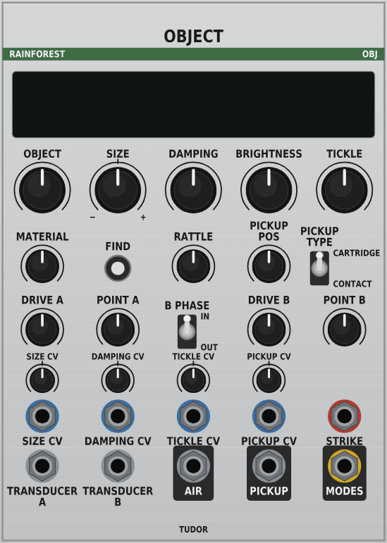

Patch audio into TRANSDUCER A or B and the object rings. **AIR** is what you hear standing next to it. **PICKUP** is what a pickup on its surface hears. Both share the object's modes but weigh them differently, so PICKUP is the "harmonically shifted reflection" of AIR.

| Control | What it does |
|---|---|
| OBJECT | Fourteen modelled objects (BEDSPRING, WINE BARREL, OIL DRUM, WAGON RIM, MILK-CAN LID, COPPER STILL, STYROFOAM BOX, STEEL CABLE, MICA SHEET, GOURD, GLASS PLATE, ALUMINIUM SHEET, HARD-DRIVE PLATTER, WHISKER DISK) and FOUND. The display shows its name. |
| MATERIAL, FIND | FIND builds a new random object of the chosen material (METAL, WOOD, GLASS, PLASTIC, CARD) and switches OBJECT to FOUND. The found object is saved with the patch. |
| SIZE | ±2 octaves. Turning it up makes the object bigger, so it sounds lower. |
| DAMPING | How long it rings: up to 4× longer at 0, 4× shorter at 1. |
| BRIGHTNESS | How long the high modes ring compared with the low ones. |
| TICKLE | Tudor said the transducers were "highly non-linear... like tickling someone". At 0 the object is linear. Turning it up makes loud drive bend the pitch, makes energy jump between unrelated modes, and gives sudden "it caught" moments. |
| RATTLE | A loose contact that buzzes when the object moves enough. Strong on BEDSPRING, STEEL CABLE and WHISKER DISK. |
| DRIVE A, POINT A, DRIVE B, POINT B | Level and position of each transducer. Some positions sit on nodes and barely excite some modes. |
| B PHASE | OUT inverts B. Two transducers out of phase was Tudor's trick for sounds "that did not exist in the source material". The same signal into A and B at the same point with B PHASE OUT cancels. |
| PICKUP POS, PICKUP TYPE | Where the pickup sits, and whether it is a phono CARTRIDGE (good bass, fast high roll-off) or a CONTACT mic (brighter). |
| STRIKE | A trigger taps the object at POINT A. Handy for hearing an object without a source. |
| MODES | 8 channels: the 8 currently strongest modes as V/oct, strongest first. |

The display shows a bar for every mode (x is frequency, height is energy) and the positions of A, B and the pickup.

### CRITTER (CRT): animal-like signal generators

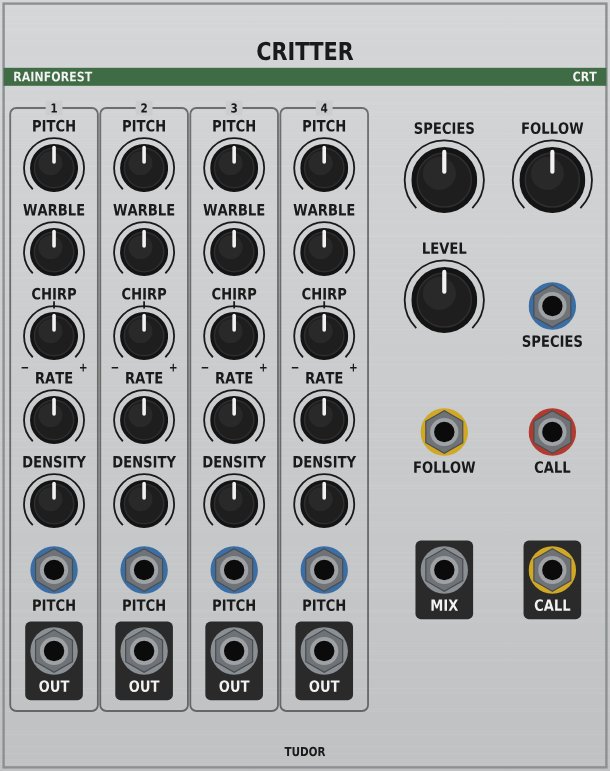

*Rainforest I* used "oscillators that made animal-like and bird-like sounds" as the objects' sources. CRITTER is four of them. They are meant to drive OBJECTs, though they work dry.

Each voice has PITCH (30 Hz to 8 kHz, plus 1 V/oct input), WARBLE (fast irregular vibrato), CHIRP (pitch sweep across each call, up or down), RATE (0.1 to 20 calls per second, with irregular gaps) and DENSITY (the chance that a scheduled call happens). SPECIES morphs all four from BIRD (syllables with chirps) through INSECT (buzzing stridulation) to FROG (low pulsed croaks). LEVEL sets the output.

**FOLLOW** is the interesting part: patch a polyphonic pitch list into the FOLLOW jack (OBJECT MODES or SEEK NODES) and turn FOLLOW up. Each voice glides toward a different pitch in the list, so the critters learn the object's voice. CALL makes every voice call at once. The CALL output is four gates, high while each voice calls.

### SEEK (SEK): find the object's voice

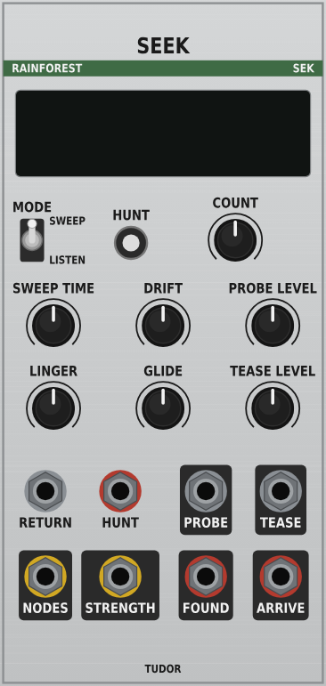

SEEK automates Tudor's method. Patch PROBE into an OBJECT's TRANSDUCER and the object's PICKUP back into RETURN, then press HUNT.

- **SWEEP mode** plays a sine sweep from 30 Hz to 12 kHz over SWEEP TIME and measures how strongly the object answers at each frequency. At the end it picks the COUNT strongest resonances.
- **LISTEN mode** plays nothing. It analyses whatever comes back on RETURN and keeps a list of peaks that follows changes at a speed set by DRIFT. HUNT clears the list.

**TEASE** is a sine that visits the found nodes. It lingers on each for about LINGER seconds with a slow vibrato that rocks it across the peak, then glides (GLIDE) to another node chosen at random by strength. Patch TEASE into the transducer to tease the nodes into strong vibration.

NODES and STRENGTH are polyphonic lists of the found frequencies (V/oct) and their strengths (strongest is 10 V). FOUND fires when a scan finishes or the list changes. ARRIVE fires when TEASE reaches a node. The display shows the measured response, the nodes, and TEASE as a moving dot. The HUNT light is on while a sweep runs.

### WANDER (WND): walk through the forest

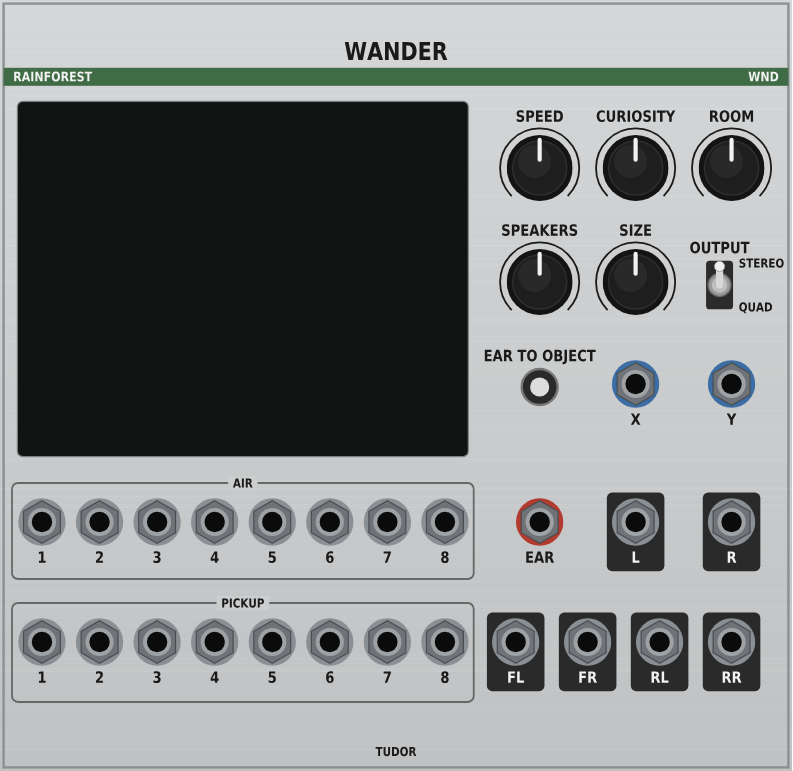

WANDER places up to 8 objects in a virtual room and walks a listener among them. Patch each OBJECT's AIR and PICKUP into a pair of inputs. AIR sounds from the object's position, PICKUP from its loudspeaker on the nearest wall. Unpatched inputs cost nothing.

| Control | What it does |
|---|---|
| SPEED | Walking speed, up to 1 m/s. |
| CURIOSITY | How strongly the path is drawn toward objects that are loud right now. |
| ROOM | Diffuse room sound. |
| SPEAKERS | Level of the pickup loudspeakers against the direct sound. |
| SIZE | Room side, 6 to 30 m. |
| EAR TO OBJECT | The listener glides to 10 cm from the nearest object and stays there: ear against the barrel. The EAR jack does the same while its gate is high. |
| OUTPUT | STEREO: the listener faces where they walk, with head shadow. QUAD: fixed orientation, north is front, four outputs FL, FR, RL, RR. In QUAD, L and R carry the front pair. |
| X, Y | 0 to 10 V moves the listener yourself (0 V = west or south wall). |

Drag the objects on the map to rearrange the room. Their loudspeakers follow to the nearest wall. Right-click the module for the default layout.

---

## Pulsers

Tudor built *Untitled* (1972) from "amplifiers (fixed or variable gain, fixed or variable phase-shift, tuned, saturating types), attenuators, filters... switches, and modulators with variable side-band capability", linked "with multiple feedback loops having variable gain and variable phase-shift", the whole conceived as a "giant oscillator". *Pulsers* (1976) added a Gordon Mumma "complex modulator", altered so that "no primary input signal is used; rather, phase-shifted feedback is the trigger source". Tom Johnson heard loudspeakers that "seem to be trying to clear their throats. They sputter and snap."

### PULSER (PLS): rhythm from phase-shifted feedback

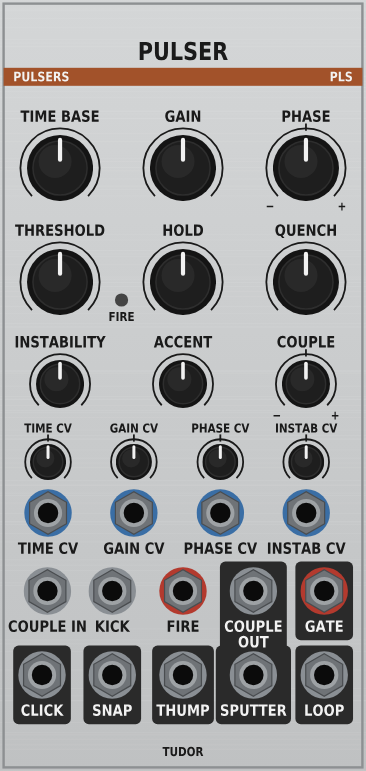

A resonant loop builds up on its own, crosses THRESHOLD, fires, is quenched, and builds up again. The rhythm comes from how fast it builds, which depends on GAIN, on PHASE (how well the loop's phase lines up with its resonance) and on whatever is coupled in. Mumma's circuit is undocumented, so this is a model of the behaviour that Tudor and Johnson describe.

| Control | What it does |
|---|---|
| TIME BASE | The loop's resonance, 0.25 Hz to 1 kHz. Above about 30 Hz firings run together into sputter and buzz. |
| GAIN | Loop gain. Below about 1 the loop does not start by itself (KICK, COUPLE IN and FIRE still disturb it). |
| PHASE | Extra phase shift in the loop. Changes tempo and accent as much as TIME BASE does. |
| THRESHOLD | Firing level. |
| HOLD | How long each firing quenches the loop. GATE is high for this time. |
| QUENCH | How much of the loop's energy each firing removes. Low QUENCH fires in bursts. |
| INSTABILITY | Lets the time base wander "and eventually become unstable", raises the noise floor and jitters the threshold. |
| ACCENT | How much each output's level follows how hard the loop overshot. |
| COUPLE | How much COUPLE IN (another PULSER's COUPLE OUT) is added to the loop. Negative inverts it. |

Outputs, each with its own character: **CLICK** (a short pulse), **SNAP** (a pinged resonator around 2.2 kHz), **THUMP** (a falling low sine), **SPUTTER** (the clipped loop under an envelope), **LOOP** (the raw loop), **COUPLE OUT** (for chaining) and **GATE**. The FIRE light flashes on each firing. KICK adds any signal straight into the loop. FIRE forces a firing.

### SHIFT (SHF): variable phase-shift amplifier

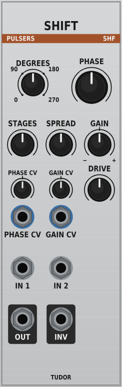

Tudor had a "vast number of phase shifting devices", many switchable to "90, 180, 270, or 360 degrees out of phase", used in feedback paths "with very unpredictable results". DEGREES gives a fixed broadband shift of 0, 90, 180 or 270 degrees across the whole audio band. Then an all-pass chain of STAGES (0, 1, 2, 4 or 8) adds a frequency-dependent shift centred on PHASE, with the stages spread over SPREAD octaves. GAIN (±2, negative inverts) and DRIVE (soft saturation) follow. IN 1 and IN 2 are summed. INV is −OUT. Put SHIFT in any feedback path to move where the loop wants to ring.

### TUNED (TND): tuned and saturating amplifier

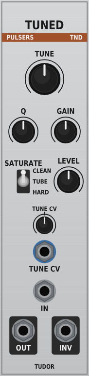

A band-pass amplifier at TUNE (20 Hz to 10 kHz, 1 V/oct CV) with Q from 0.5 to 200 and GAIN from −12 to +40 dB. The saturation is inside the resonator, so in a feedback loop it rings, howls and limits itself instead of exploding. SATURATE picks CLEAN (just the ±12 V limit), TUBE (asymmetric, adds even harmonics) or HARD (clipped, oversampled). At high Q noise in gives a near-sine ring at a steady level.

### SIDEBAND (SBM): modulator with variable sideband capability

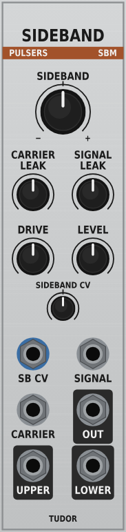

Two inputs, SIGNAL and CARRIER, and no oscillator of its own. SIDEBAND moves from LOWER sideband only (−), through both (0, a ring modulator), to UPPER sideband only (+). CARRIER LEAK and SIGNAL LEAK bring the inputs back in, so it can also behave as AM. DRIVE saturates both inputs before they multiply, like a diode ring pushed hard. UPPER and LOWER give each sideband on its own.

### LOOP (LOP): the giant oscillator

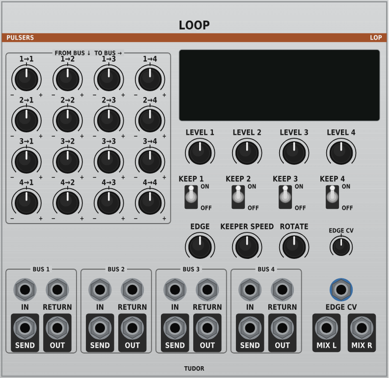

LOOP makes Tudor's method practical in Rack. It has four buses. Each bus has a SEND and a RETURN for an external component: a SHIFT, a TUNED, a SIDEBAND, an OBJECT, anything. **An unpatched RETURN is the same as its SEND**, so LOOP oscillates on its own with nothing patched.

- **The grid.** Knob `i→j` is the gain from bus *i*'s return into bus *j*, from −1.5 to +1.5 (negative inverts). By default buses feed each other in a ring (1→2, 2→3, 3→4, 4→1 at 0.7).
- **KEEP and the keeper.** Tudor's "manipulation of gain stages is legendary": he kept many stages going "without the system taking off". The keeper does that for you. It watches each bus and slowly rides its gain toward a target: up when the bus is quiet, down when it is loud. EDGE sets the target, from barely alive (0) to pushed into saturation (1). KEEPER SPEED sets how slowly it reacts, so the network swells, holds, collapses and restarts by itself. Switch KEEP off on a bus to ride it yourself.
- **ROTATE** slowly changes which crosspoints are strongest, so the network changes by itself.
- **LEVEL 1 to 4** set each OUT. MIX L carries buses 1 and 3, MIX R buses 2 and 4.

The display shows the grid (filled dots are positive, rings are negative, size is gain), each bus's level and each keeper's current gain.

---

## Phonemes

*Phonemes* (1981) used "a customized percussion generator with the ability of extending attacks up to several seconds in length" and "a vocoder capable of chopping a sound into small pieces". "Tudor takes short sounds and lengthens them and in turn, long sounds and shortens them." The overlap "reminded him of speech".

### SWELL (SWL): percussion with extendable attacks

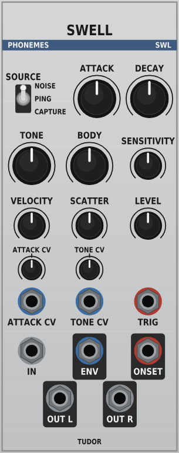

SWELL listens for hits in IN (SENSITIVITY sets how easily), or takes TRIG, and fires one of four voices. ATTACK runs from 1 ms to 8 s, so a short hit can become a slow swell. DECAY runs from 5 ms to 10 s. VELOCITY sets how much the hit's strength sets the voice level. SCATTER varies attack, tone and stereo position per hit.

SOURCE picks the voice:
- **NOISE:** filtered noise at TONE. BODY sets the resonance.
- **PING:** a two-mode resonator at TONE, kept ringing by quiet noise under the envelope, so a long attack swells like a bowed gong instead of fading in. Short attacks still click.
- **CAPTURE:** grabs the hit itself from IN and stretches it with overlapping grains. BODY sets the grain size and TONE detunes it gently. This is "short sounds lengthened".

ENV is the sum of the voice envelopes (0 to 10 V). ONSET fires on each detected hit.

### PHONEME (PHN): the chopping vocoder

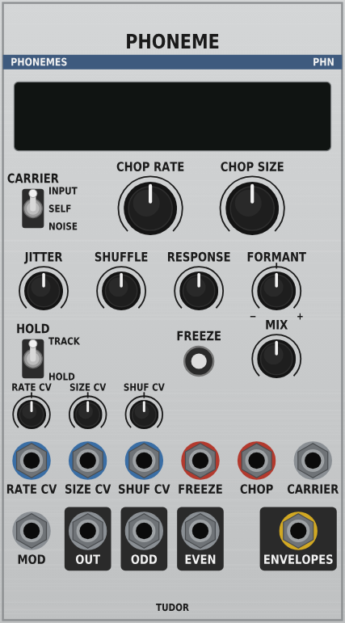

A 16-band vocoder whose band levels are chopped: sampled, held and gated in short pieces, so long sounds are cut up and re-voiced into speech-like fragments. "Long sounds shortened."

| Control | What it does |
|---|---|
| CARRIER | INPUT uses the CARRIER jack (SELF if unpatched), SELF uses the modulator itself, NOISE uses internal noise. |
| CHOP RATE, CHOP SIZE | How often a chop opens (1 to 60 Hz) and how much of each period it stays open. A trigger in CHOP replaces the internal rate. |
| JITTER | Random chop timing, and random dropping of single bands per chop. |
| SHUFFLE | Per chop, sends analysis bands to other synthesis bands. Strongly speech-like. |
| RESPONSE | How fast band levels fall (2 to 200 ms). |
| HOLD | HOLD samples the band levels at the start of each chop. TRACK lets them follow, still gated. |
| FREEZE | Holds the current band levels for as long as it is on (button or gate). |
| FORMANT | Shifts the synthesis bands up to one octave either way. |
| MIX | Dry modulator to vocoded. |

ODD and EVEN carry the odd and even bands, a natural stereo pair. ENVELOPES is 16 channels of chopped band levels for driving other things. The display shows the bands, the chop gate, and the shuffle mapping as lines from the analysis row to the synthesis row.

### XGATE (XGT): cross-gating and channel switching

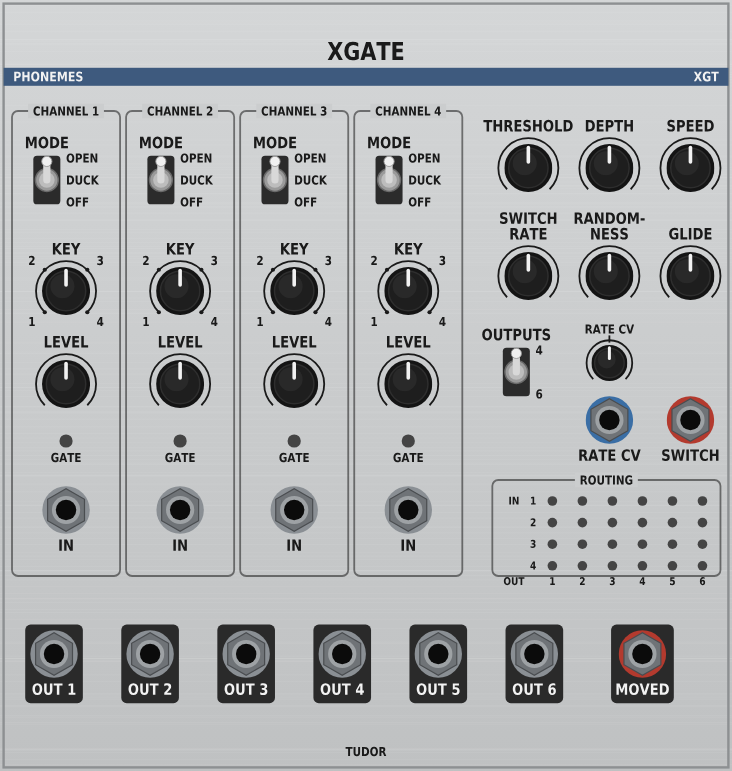

On the *Pulsers* record, Nicolas Collins' automated mixer "cross-gated" the tapes. In *Untitled*, a chain switched its outputs "amongst four channels in the performance space". XGATE does both.

- **Cross-gating.** Each channel's gain is set by another channel's level, chosen with KEY. MODE OPEN sounds while the key is loud, DUCK sounds while it is quiet, OFF ignores the key. A channel keyed to itself is a plain noise gate. THRESHOLD, DEPTH and SPEED shape the gate. The GATE lights show each channel's opening.
- **Switching.** Each channel starts on the output of its own number. At SWITCH RATE (irregular as RANDOMNESS rises) one or more channels move to another output, crossfading over GLIDE. RANDOMNESS also sets how many move at once. OUTPUTS picks 4 or 6. A trigger in SWITCH forces a move, and MOVED fires on each. The small grid shows which output each channel is on.

---

## Patch recipes

### 1. One object, found by ear (Rainforest IV, the basic patch)

1. OBJECT on WINE BARREL. SEEK PROBE → OBJECT TRANSDUCER A. OBJECT PICKUP → SEEK RETURN.
2. Press HUNT and wait for the sweep. The display shows the barrel's response and its nodes.
3. SEEK TEASE → OBJECT TRANSDUCER B. OBJECT AIR → your mixer or audio interface.
4. Turn TICKLE to about 0.5 and DAMPING down a little. The tease tone lingers on each node and the barrel catches and blooms.
5. Try B PHASE OUT, and move POINT B toward POINT A.

### 2. Rainforest I: critters in a barrel

1. CRITTER OUT 1 and OUT 2 → OBJECT TRANSDUCER A and B (WINE BARREL or GOURD). OUT 3 and 4 → a second OBJECT (MILK-CAN LID).
2. OBJECT MODES → CRITTER FOLLOW, FOLLOW at 0.6. The critters drift onto the barrel's own pitches.
3. SPECIES between BIRD and INSECT. Turn RATE down on the voices driving the second object.
4. Listen to both AIRs. Turn TICKLE up on the lid for sudden flare-ups.

### 3. Walking through Rainforest IV

1. Build four to eight OBJECTs, each driven by its own source: CRITTER voices, SEEK TEASE, SWELL, or PULSER SNAP.
2. Patch each AIR and PICKUP into a pair of WANDER inputs.
3. SPEED 0.3, CURIOSITY 0.6, ROOM 0.3, SPEAKERS 0.5. Drag objects on the map to make open paths.
4. Use EAR TO OBJECT now and then, or patch a slow random gate into EAR, to put your ear against an object.
5. For a hall, add Valley Plateau or Surge XT Reverb 2 after WANDER.

### 4. Pulsers: six coupled pulsers

1. Six PULSERs. Patch each COUPLE OUT into the next one's COUPLE IN, the sixth back into the first. COUPLE at 0.3 on each.
2. Set TIME BASE between 3 and 9 Hz, a little different on each. INSTABILITY 0.2 to 0.4.
3. Take a different output from each: CLICK, SNAP, THUMP, SPUTTER, LOOP and CLICK again.
4. Send them through XGATE (6 outputs, SWITCH RATE 0.2) to six channels, or through WANDER's PICKUP inputs for a stereo mix.
5. Ride PHASE and GAIN by hand, or map them to a MIDI controller.

### 5. Untitled: the giant oscillator

1. LOOP with nothing patched already oscillates. Start with EDGE 0.4, KEEPER SPEED 2 s.
2. Bus 1: SEND 1 → SHIFT IN 1, SHIFT OUT → RETURN 1. DEGREES 90, STAGES 4.
3. Bus 2: SEND 2 → TUNED IN, TUNED OUT → RETURN 2. Q 30, SATURATE TUBE.
4. Bus 3: SEND 3 → SIDEBAND SIGNAL, SEND 4 → SIDEBAND CARRIER, SIDEBAND OUT → RETURN 3. SIDEBAND at +0.6.
5. Bus 4: SEND 4 → an OBJECT TRANSDUCER A, OBJECT PICKUP → RETURN 4.
6. Add crosspoints by ear: 1→3, 2→4, a negative 3→1. Turn ROTATE up slowly. Listen to MIX L and MIX R.
7. Switch KEEP off on one bus and ride its LEVEL and crosspoints yourself. That is the performance.

### 6. Phonemes: lengthened and shortened

1. A source with sharp attacks and a sustained tail: a PULSER's SNAP, or a recording played from any sampler module.
2. Same source → SWELL IN and PHONEME MODULATOR.
3. SWELL: SOURCE CAPTURE, ATTACK 2 s, DECAY 3 s. Short hits come out stretched.
4. PHONEME: CHOP RATE 9 Hz, SHUFFLE 0.4, JITTER 0.3, CARRIER NOISE. Long sounds come out chopped into syllables.
5. SWELL OUT L and PHONEME ODD → XGATE IN 1 and IN 2. KEY 1 = 2 and KEY 2 = 1, both DUCK, so each speaks when the other is quiet.
6. XGATE OUT 1 to 4 to four channels, or through WANDER.

### 7. Feedback through an object

1. OBJECT PICKUP → TUNED IN, TUNED OUT → OBJECT TRANSDUCER A. This is a feedback loop through the object, as with a microphone and loudspeaker.
2. TUNED GAIN +20 dB, Q 4, TUNE near a strong mode (watch OBJECT's display). SATURATE TUBE keeps it bounded.
3. Move POINT A and PICKUP POS slowly: the howl jumps between modes.

---

## Using other VCV modules alongside

| Need | Module | Why |
|---|---|---|
| Room reverb after WANDER or on PULSER outputs | Valley Plateau, Surge XT Reverb 2 | WANDER's ROOM is a small room on purpose. |
| A pitched resonator as a contrast to OBJECT | Audible Instruments Resonator | A different, tonal resonator. Useful in LOOP returns. |
| Real spring character | Befaco Spring Reverb | One module, sounds right in a LOOP return. |
| Channel strips and plain mixing | MindMeld MixMaster, VCV Mixer | Not worth reinventing. |
| Recording 4, 6 or 8 outputs as stems | VCV Recorder, NYSTHI multitrack recorders | Tudor and Collins built the records from multitrack tapes. |
| A clean vocoder to compare with PHONEME | Surge XT Vocoder | It does not chop, so it is not a substitute. |
| Hand control of many loop gains | VCV MIDI-Map, Stoermelder MIDI-CAT | Tudor rode dozens of knobs by hand. Mapping LOOP and PULSER knobs to a controller is the real way to play this set. |

## What is from the sources and what is invented

**From the sources:** transducers on objects with pickups; phono-cartridge and contact-mic pickups; the object list; the transducers' weak bass and "highly non-linear" response; two transducers out of phase; animal-like oscillators for *Rainforest I*; the audience walking among objects; *Pulsers*' phase-shifted feedback as the trigger source, its unstable time base, its several outputs of different character and its six channels; Collins' cross-gating mixer; *Untitled*'s component types, feedback loops and four-channel switching; phase shifters switchable to 90, 180, 270 and 360 degrees; *Phonemes*' long-attack percussion generator and chopping vocoder.

**Designed for this set (no schematics exist):** every circuit model, constant and range; the object presets, which are plausible physics rather than measurements; PULSER's loop topology; PHONEME's band count and chop method; SWELL's three sources; SEEK, WANDER and LOOP's keeper, which automate what Tudor and the *Rainforest* performers did by hand and by ear.

Sources are listed in CREDITS.md in the repository.
